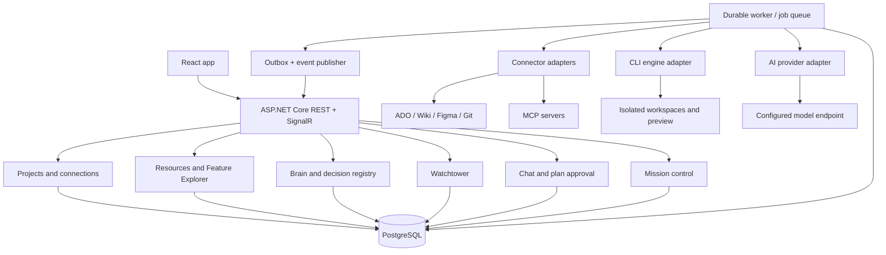

# 04 — System architecture

## Architecture decisions

Local-first modular monolith, single operator, project-scoped data. **Backend:** .NET 10 LTS with ASP.NET Core Minimal API, EF Core + Npgsql, one hosted import worker. **Frontend:** React with strict TypeScript, Vite, React Router and TanStack Query; use semantic HTML and accessible primitives. **Data:** PostgreSQL local, Compose for the DB, not an app hosting requirement. No separate queue, worker process, SignalR, graph engine, global client state store or vector database for the MVP. Keep versions exact and reproducible after G0. Validate Windows 11 first; do not assume Docker/WSL2 readiness or cross-platform parity before a host proof.

## Local MVP runtime and boundaries

- **Packaged topology:** one loopback HTTPS ASP.NET process serves the built SPA and its same-origin API; PostgreSQL listens only internally or on loopback. Development Vite can proxy same-origin requests to the local API. SPA routing fallback serves only navigation requests, never masks missing API/media endpoints. The browser makes no provider or MCP API calls; system-browser auth and opening original provider links are explicit exceptions to this networking boundary.
- **API:** route groups by feature; authenticate and validate route/body before calling a use case. Map results to documented HTTP status and Problem Details. No direct EF queries or provider SDK calls in route handlers; no universal repository abstraction wrapping EF. Expose explicit DTOs and generated OpenAPI, not persistence entities. Application owns scoping, state transitions, validation and typed ports; Domain owns identity/link/decision invariants; Infrastructure owns EF, MCP clients, OS vault and provider-specific mappings. New abstractions require a concrete second need.
- **Frontend:** routes own navigable project/feature/resource IDs and linkable tabs. TanStack Query owns server state, keys include project and entity identity; invalidate scoped queries after local mutations and at import completion. Keep transient form state local. Avoid persistent browser cache of tokens or protected snapshots; clear/refetch scoped cached data on lock, project switch and access changes. Show server-derived status, not client guesses. See [03_UI_UX_SPEC.md](03_UI_UX_SPEC.md#local-mvp-ui-contract).
- **Import worker:** persist `Queued` before returning acceptance; allow one active probe/sync run on the laptop. Enforce admission in the database so concurrent requests cannot both create an active run. An identical request for the same active operation, connection and config version returns that run; other concurrent requests return `SYNC_BUSY`. The worker reads only the bounded configured target set, with timeout/cancellation and capped read retries. Do not keep a DB transaction open across network calls. In one transaction store the resource version, pointer, observation/change and checkpoint for each successful batch; unfinished work stays incomplete. Apply the result only if the connection generation still matches.
- **Recovery:** on startup, mark leftover `Queued` or `Running` rows `Interrupted`; preserve committed data and never call a provider merely because the app opened. Use `Succeeded` when all requested targets completed, `Partial` when at least one succeeded and at least one failed/skipped due to unavailable coverage, `Failed` when none succeeded, `Interrupted` after process recovery, and `Cancelled` only for an explicit cancellation. Retry as a new run following operator action. UI polls job status only while a run is pending; no timed background calls to providers.
- **Operational defaults:** target 30-second timeout for a normal provider call, at most two bounded transient read retries within a documented run deadline, honor Retry-After or end in Rate Limited rather than waiting indefinitely, one active import globally, hard caps on targets/payload/media. Set initial caps from G0 sizes; exceeding them reports truncated or partial coverage, never an inferred deletion. Migrations are explicit and versioned; verify startup against an existing DB and avoid automatic destructive resets. No private provider config in readiness or structured logs.

The diagram, preview, advanced workflow and event architecture below describe later stages where they go beyond this MVP contract.



## Repository layout

```text
/dev-prism-ai
  AGENTS.md
  docs/spec/                  # this pack
  docs/adr/                   # approved deviations
  src/DevPrism.Api/           # route handlers, auth, middleware, hub
  src/DevPrism.Application/   # use cases, orchestration, ports, validation
  src/DevPrism.Domain/        # types, state transitions, policy models
  src/DevPrism.Infrastructure/# EF, adapters, job queue, process runner, secrets
  src/DevPrism.Worker/        # optional executable only if isolation requires it
  web/src/
    app/                      # routing, layout, providers
    features/                 # project, explorer, graph, watchtower, chat, missions
    shared/                   # API client, components, utilities
  tests/DevPrism.UnitTests/
  tests/DevPrism.IntegrationTests/
  tests/DevPrism.AdapterTests/
  web/e2e/
  demo/dishrate-seed/         # separate repo fixture template, not embedded target git history
  infra/compose.yaml
  scripts/                   # bootstrap/check/demo commands
```

Dependency direction Domain <- Application <- Infrastructure/API. API composes dependencies, does not implement orchestration logic. Domain does not reference EF, network, AI SDK, Git or ASP.NET. Infrastructure implements ports. Split further only if useful; worker can initially be a hosted service inside API, but child coding processes always separate isolation boundary. Use typed records/enums, explicit cancellation, structured ProblemDetails, UTC timestamps, versioned JSON contracts, parameterized SQL, deterministic transition validation.

## Components and contracts

| Component | Owns | Does not own |
|---|---|---|
| ProjectRegistry | scoped config, capability probes, workspace registration | provider secrets in plaintext |
| ResourceSync | fetch, normalize, snapshots, tombstones, events, cursor | canonical remote edits |
| FeatureService | feature membership, resource browsing, search | guessing confirmed links |
| Brain | typed graph, decision versions, context selection | raw unbounded chat memory |
| Watchtower | checks, findings, coverage, impact candidates | direct writes or unsupervised AI loops |
| Chat | conversation, read tools, plan proposal | approval, command execution |
| ActionService | plan/version hash, approval, dispatch, receipt reconciliation | arbitrary tool names supplied by model |
| MissionScheduler | DAG, leases, attempts, cancellation, integration gates | LLM implementation internals |
| CodingEngineAdapter | launch/parse/cancel/collect engine run | permission decisions, merge or external writes |
| Audit/Events | durable domain event, redacted journal and usage | secrets, hidden reasoning |

Illustrative ports (names and signatures subject to implementation refinements, no dependency on vendor-specific SDK in Domain):

```csharp
public interface IResourceConnector {
    Task<CapabilityReport> ProbeAsync(ConnectionRef connection, CancellationToken ct);
    IAsyncEnumerable<ResourcePage> ReadAsync(SyncRequest request, CancellationToken ct);
    Task<ResourceSnapshot> ReadOneAsync(ExternalResourceRef target, CancellationToken ct);
}
public interface IExternalActionAdapter {
    Task<ActionPreflight> PreflightAsync(AuthorizedAction action, CancellationToken ct);
    Task<ActionReceipt> ExecuteAsync(AuthorizedAction action, CancellationToken ct);
    Task<ReconciliationResult> ReconcileAsync(ActionAttempt attempt, CancellationToken ct);
}
public interface IModelProvider {
    Task<ModelCapabilities> ProbeAsync(ProviderRef profile, CancellationToken ct);
    IAsyncEnumerable<ModelEvent> StreamAsync(ModelRequest request, CancellationToken ct);
}
public interface ICodingEngine {
    Task<EngineCapabilities> ProbeAsync(EngineProfile profile, CancellationToken ct);
    IAsyncEnumerable<EngineEvent> RunAsync(AuthorizedAgentRun request, CancellationToken ct);
    Task StopAsync(RunHandle handle, CancellationToken ct);
}
public interface IContextBuilder {
    Task<ContextPack> BuildAsync(ContextRequest request, CancellationToken ct);
}
```

`AuthorizedAction` and `AuthorizedAgentRun` are server-produced from validated approval and policy, never deserialized directly from user/model. Adapters return normalized typed status, source IDs, revisions, capability constraints, error codes and redacted evidence. Unknown is a first-class result. Raw provider responses retained only if policy permits and size-bounded.

## Runtime data flow

MVP read path: UI -> local Minimal API -> indexed DB -> scoped response; no model or network call to a provider. MVP sync path: persisted job -> typed remote MCP read -> validated normalization -> atomic snapshot/pointer/observation/checkpoint -> status polling and query refresh. Later write path: draft -> validate typed plan -> immutable version/hash -> human approval -> enqueue -> preflight -> receipt and verified reread. Later coding path: approved mission -> workspace contract -> isolated runner -> independent checks -> preview -> separately approved PR/merge. Never execute unknown model tools or unapproved commands.

## Durability and concurrency extensions (post-MVP event and action workflows)

PostgreSQL durable jobs with `FOR UPDATE SKIP LOCKED` claim, lease owner, expiry, heartbeat and attempt limit. Single local API/worker is sufficient, but jobs designed for restart. Transactional outbox records committed events; broadcaster reads outbox after commit, at-least-once UI delivery, cursor dedupe. Unique idempotency keys scoped by project + operation type + request hash; same key different body = 409. Lock per connection sync; per repository integration/merge; per mission transition. Avoid holding DB transaction during network calls. Use optimistic version number for plan approval, decision, mutable local records. Each external action attempt has `Started` persisted before sending request, result verified before `Succeeded`; crash between call and commit yields `Unknown` until reconcile. Retry reads with jitter and Retry-After; writes only when preconditions and provider idempotency/absence confirmed. No claims of exactly-once across providers.

## Deployment topology

Local browser -> loopback HTTPS or secure local origin, ASP.NET serves built UI for production; dev Vite proxy only to registered local API. PostgreSQL in Compose, loopback-only or internal Docker network; separate dev DB for DishRate. Worker uses dedicated sandbox; no Docker socket access inside agent sandbox. Preview bound to loopback with dedicated port and isolated origin. No exposed public API or internet-facing service. Secrets in OS credential store or secret service; dev env variables only with explicit guidance. Production remote hosting, team auth/RBAC and multi-tenant isolation require a new ADR and threat model. Optional local background sync stops when service stops. UI indicates no active monitoring while app is closed.

## Extended nonfunctional targets (not Local MVP release gates)

Targets, not measured: cached feature load p95 < 500ms on 5k resources/20k relations local test fixture; list pages max 100, graph cap 150 nodes default; log UI virtualized; source snapshots text max configurable 1MB by default; binary metadata only; network requests timeout 30s except dedicated bounded streams; sync concurrency 2 and agent concurrency 2 default; job limits enforced centrally. Measure with actual hardware; degrade gracefully with stale cache and explicit missing data. Observability: correlation ID, project/mission/action IDs, timings, safe structured logs; no prompt body by default. OpenTelemetry optional after basics.
