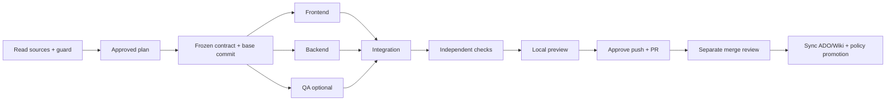

# 10 — Coding engine, DAG, Git and preview

This is a post-MVP design for G7–G8. The Local MVP does not invoke coding engines or rely on a verified execution sandbox. Do not begin this track merely because remote MCP reads passed.

## Strategy

Do not build a coding engine from scratch. DEV PRISM AI orchestrates existing CLI engines through adapter interfaces. OpenCode first candidate due to provider flexibility; Codex alternate if authorized and compatible. Pin exact installed version and test noninteractive output/permissions; config differs across OpenCode versions. Runtime does not depend on Roo Code or VS Code. .NET controls child process through `ProcessStartInfo.ArgumentList`, redirected asynchronous stdout/stderr, cancellation and isolated execution supervisor; never shell-concatenate user/model strings. Microsoft Agent Framework optional, not needed for deterministic DAG.

## Engine validation and runtime contract

Before G7, run the authorized SP-02/SP-05 probes in a disposable repo: use the actual permitted model, edit one file and run a check, and verify machine-readable events, permissions, working directory, process-tree cancellation, sanitized logs, credential separation, usage and sandbox isolation. If OpenCode fails, evaluate the authorized alternative; if neither is safe, block coding and keep the read/action product. Validate the installed CLI version, prompt delivery and permissions before setting a runtime contract. Prefer a supported stdin/file interface over sensitive command-line text. Do not enable full-access modes for the demo.

Engine adapter receives task ID, authorized workspace, base SHA, frozen contract hash, role, allowed path roots, read context refs, test profile ID, budget/time limit, provider profile reference. Returns normalized events (`Started`, `Output`, `ToolObserved`, `Usage`, `FileChanged` only if observed, `Exit`, `Error`, `ApprovalNeeded`). Capture JSON lines with schema version, tolerate unknown events as redacted text, cap line/output, independently inspect diff and test. Never parse model claims as proof. Exit code zero alone not success. Kill process group/container on cancellation/timeout; verify stopped. Secrets scoped to necessary model access only; no ADO/Git credentials, host mounts or Docker socket in worker. If engine requests unsupported permission, fail closed with visible reason, no automated “yes”.

## Agent roles and workspace ownership

| Role | Inputs | Writable scope / output |
|---|---|---|
| Planner | feature sources + rules | proposed DAG only, no source changes |
| Architect | acceptance, current API/schema | versioned contract artifact in controlled shared baseline; approval before fan-out |
| Frontend | design excerpt, frozen API, FE rules | `web/src/**`, FE tests if assigned; no shared contract edits |
| Backend | API/schema/rules | `src/**`, migrations; no FE edits |
| QA (optional) | acceptance + contract | independent `tests/Acceptance/**`; cannot weaken mandatory tests |
| Integration | actual commits/diff and checks | integration worktree; conflict repair via new task/approval if needed |

Exact paths resolved per target project, not hardcoded to DishRate. Path ownership is enforced by sandbox mounts/permissions where possible and post-run Git diff check always. Read access scoped to selected repository; unrelated host inaccessible. For a shared file, assign one owner and serialize dependencies. Contract modifications are isolated in prior commit or controlled immutable artifact available in all workers. Agent output proposing contract change triggers pause/replan, not silent modification. QA can build contract tests in parallel only if stable interface; execute integration tests after merge.

## Scheduler

DAG node types: read/import, analysis, plan, contract freeze, coding task, check, integrate, preview, external action, review, promotion. Validate graph topologically; reject cycles/missing nodes and incompatible path claims for concurrent nodes. `Ready` when required deps verified, budget/approval valid and no conflicting ownership. Scheduler uses DB job leases and global/per-project/per-mission concurrency (2 agents default). Deterministic scheduling by plan order then key. Reserve estimated budget and workspace per attempt, release on terminal. Use cancellation token and durable event log. No nested uncontrolled subagents; if engine supports subagents, disable or bound under same budget/policy. Parallelism may increase tokens; measure not assume.

Example:

No fake progress percent. UI shows completed tasks / total, actual times, run states. If an agent fails, dependent blocked; independent task may complete safely. Retry only new attempt, fresh branch/workspace from approved base or explicitly approved existing commit. Preserve failed diff for diagnosis. On unexpected restart, mark running attempts Interrupted, verify owned sandbox process and stop/reconcile; no blind reattach or relaunch. Task graph transitions and leases atomic; integration and merge serialized per repo. Cancellation stops future work and terminates owned processes, not already applied remote writes.

## Git lifecycle

1. Register clean dedicated clone; user's existing dirty checkout never touched. Fetch authorized remote if requested; capture default branch target SHA and local baseline. Require expected branch, no force operations. Mission branch naming `devprism/m-<shortuuid>/integration`; task branches `devprism/m-<id>/<role>-<attempt>`. Validate `git check-ref-format` and collision; generated names only.
2. Contract commit on integration baseline before fan-out (or immutable artifact separate, recorded hash). Create separate Git worktree/copy per task from same frozen SHA. For hardened isolation use a private clone/copy inside sandbox if shared `.git` would expose repository metadata/write access; broker imports patch/commit after validation. Worktree is convenience, not security boundary. No remote credentials or arbitrary hooks in agent runtime. Disable untrusted Git hooks/config; broker uses explicit Git args. Validate no symlink escape, submodule surprises, binary or secret changes outside scope.
3. After agent completes, broker inspects diff including untracked files; reject unexpected path, protected test modification, secrets, unsafe config. Run task-level checks and create commit in controlled workspace with sanitized message referencing mission and actual ADO item. Record commit and base SHA. Agent may not push/merge. Git commit identity configured demo user; no impersonation.
4. Integration checkout based on frozen base; merge/cherry-pick task commits in deterministic approved order (FE, BE, QA or dependency order). If conflict, stop, list files/hunks, preserve state, allow explicit manual or bounded resolution task. Do not automatically choose ours/theirs. Validate full combined diff. Run independent build/tests and guard at exact head. Record test evidence and contract hash; invalidate if diff changes. If main advances, show stale base; fetch/rebase or merge via authorized replan, rerun checks, new review. Never reset main or force push.
5. Preview from exact integration commit; operator checks result. Push integration branch only after explicit external-action approval referencing head/base/remote. Create draft PR when supported with summary, test evidence, decision refs, actual work item links. Use authorized provider. Verify remote branch SHA and PR response; duplicate PR reconciliation. Do not infer merge from exit code. Separate merge approval with current target SHA, PR state and policies. If policy pending or reviewer required, leave AwaitingReview; no bypass. Reread merge result and actual target commit. Update ADO state and Wiki in approved follow-up actions only; if merge blocked, no “Done”.
6. Cleanup sandbox/worktrees only after no live process, preserve logs/commit/evidence per retention. Delete local temporary branches only with configured cleanup policy; remote branch delete optional explicit approval. Never remove user's working tree. On preview failure, keep commit and diagnose.

## Local preview

Target app provides approved preview profiles (e.g. Docker Compose known file + commands) configured by operator, not generated free-form by model. Run build/start in isolated environment with dedicated test DB and synthetic data, loopback ephemeral port, restricted network and resources. No production database, cloud deployment or privileged containers. Validate compose config (no host mounts, privileged, socket, broad network or secrets); use trusted wrapper and project-approved images. Track PID/container IDs and health endpoint, startup timeout, logs and SHA. `Running` only after health check; display URL and branch SHA; stop cleans owned runtime and temporary DB per policy. If port collision allocate allowed port. Do not iframe untrusted origin with access to control-plane credentials; open separate browser tab. Optional public deployment later with separate security/infra approvals.

## Acceptance

Two independent agent tasks start before either completes, separate workspaces, common contract SHA. Actual diffs show expected ownership. Inject overlapping path to prove scheduler serializes/rejects. Inject conflicting edit to prove integration stops. Engine exit zero with no expected output fails acceptance. Cancellation kills child process tree. Restart preserves task attempts and unknown actions. Test fail or main advancement prevents merge. Preview health and exact commit visible. No provider key in logs or repository. Report actual usage or unavailable. All operations on dedicated demo project only.
